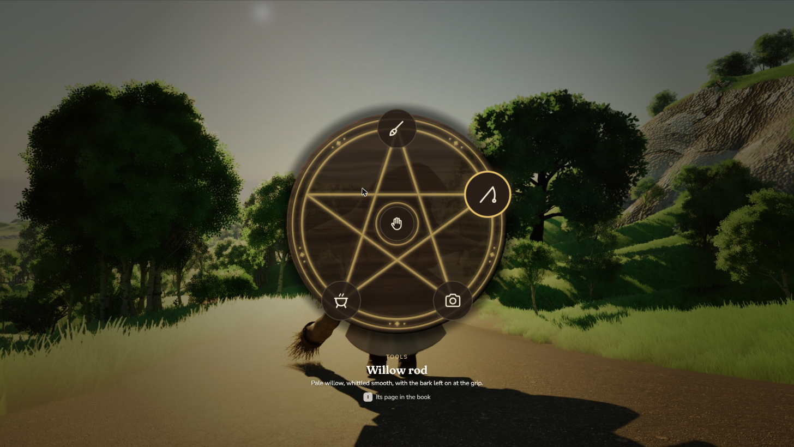

# Handoff: the tool wheel as a pentacle

**What:** the tool wheel's new figure. The five tools sit on the points of a pentacle carved into a dark
wooden disc, **Hands free sits in the centre**, and the grooves glow gold and slowly breathe. The aimed
tool's name and flavour line move from the middle of the wheel to below it.
**Decided:** `direction.md` D35 (user, 2026-10-11): *"it adds much more of a 'witchy' vibe to the
wheel"*. D33: six places at most, five tools and Hands free.
**Bench reference:** screen `quick_select` (kind `tool`), scene *Flow — in the world*, press T
(`http://localhost:5320/#scene=flow-world`; also `flow-night` for the dark test). The pentacle is the
default; variant *Tool wheel: Ring of six* shows the wheel as it was.
**What it changes:** the game's wheel as built (`documents/prd/ui/tool_wheel_prd.md` 0.2.5, stages 1a and
1b). Everything not listed here stays as built: hold to open and release to take, aiming by direction,
the release table, the slots' look and aimed state, the scrim, the motion, the sounds, the data.



> Build from this document, not from the bench's HTML/CSS. Values are Slate units at a 1920×1080
> reference (1 CSS px ≈ 1 Slate unit). Colours are sRGB hex: convert with `FLinearColor::FromSRGBColor`.

## 1. The places

Five points, 72° apart, clockwise from the top; the broom's point is straight up (an upright pentacle).
Hands free leaves the ring for the centre.

| Place | Angle | Kind | Notes |
|---|---|---|---|
| Point 0 | 0° (top) | Broom (`Item.Tool.Broom`) | As before: the signature tool, the easiest flick |
| Point 1 | 72° | Fishing rod (`Item.Tool.FishingRod`) | |
| Point 2 | 144° | Camera (`Item.Tool.Camera`) | |
| Point 3 | 216° | Cauldron, when it is a tool | Bench D33/D34. The game's roster has it undecided, and the bench has it "for now": it may leave the wheel (`direction.md`, Open) |
| Point 4 | 288° | Free | The game's `tools.md` intends a net |
| **Centre** | none | **Hands free** | Replaces the bottom place (180°) |

- **Six places at most** (D33): the figure has no room for a seventh, so the places table is now a
  ceiling. A kind that isn't a tool yet stays out of the table, as before.
- **Nearest-angle aiming is unchanged**, over the five points. Hands free is no longer one of the angles.

## 2. Choosing Hands free in the centre

⚠️ **Not settled** (`direction.md`, Open). The built wheel keeps the aim when the stick springs back or the
pointer returns (decision 2), which is right and stays. So "the stick at rest" can't mean the centre, and
the centre needs a deliberate input. The bench's proposal, for the plan phase to settle:

| Input | Aims at Hands free |
|---|---|
| Pad | **Click the aiming stick** (R3) while the wheel is held. Tilting past the deadzone aims at a point again |
| Mouse | The virtual pointer **inside an inner radius** (proposed 70: inside the small carved ring round the centre). The mouse doesn't spring back, so a pointer left in the middle is a choice |
| Keys / D-pad | Stepping runs round the five points and then **the centre**, then on to the first point |

- Releasing on Hands free does what it did at the bottom (the release table, unchanged): put away, or
  nothing with her hands already empty.
- **Nothing aimed still means nothing happens.** On opening, nothing is aimed, as before.

## 3. A point with no tool

- **The carved point is always there**: it's part of the figure, so the wheel's shape stays whole without
  drawing an empty slot.
- **No slot is drawn** at a point whose kind she has nothing of (the bench's default). The alternative,
  kept as bench variant *Wheel: missing tool*, is an empty slot reading *Something goes here*.
- 🔴 **The kind is never named** (user, 2026-10-09: "A place for a fishing rod" gives it away). This
  replaces decision 5's named empty place, *A place for a fishing rod / Mark one in the Satchel*.

## 4. Layout

```
UWitchcraftToolWheelScreen   (GameMenu layer, Game input, no focus: as built)
└─ SOverlay  (full screen)
   ├─ Scrim                                     as built
   ├─ SBox 620 × 620, centred on the screen     the wheel
   │  └─ SOverlay
   │     ├─ SImage  T_ToolWheel_Pentacle        620 × 620, fills the box (§6)
   │     ├─ SImage  T_ToolWheel_PentacleGlow    620 × 620, tint GlowColor, render opacity animated (§6, §7)
   │     └─ SWitchcraftToolWheel                the slots (as built), laid out as below
   └─ SBox 440 wide, centred horizontally, top at y = 854     the text (§5)
```

| | Value |
|---|---|
| Wheel box | 620 × 620, centre (960, 540) |
| Points | radius **230** from the centre (the carved circle passes through them) |
| Point slot | **96** round, icon 44: as built |
| Centre slot (Hands free) | **84** round, icon 38, the open hand (`Icon.Hand`), centred (960, 540) |
| Aimed slot | as built: scale 1.14, accent border, 24-unit glow at 35% |

Measured in the bench at 1920×1080: broom slot (912, 262)–(1008, 358); camera (1047, 678); cauldron
(777, 678); Hands free (918, 498)–(1002, 582).

- The texture's disc has radius 267 (0.43 of the box) and its soft shadow reaches ~298, inside the box.
  The slots at the points overhang the carved circle by half a slot, as in the picture.
- At 21:9 nothing moves: the wheel is centred, and only the scrim covers more.

## 5. The text below

What was in the middle of the wheel moves below it, so the centre is free for Hands free. The **content
and its rules are unchanged** (decision 5's *centre*: the aimed tool, the held tool when nothing is
aimed, *Hands free / Put it away*).

| Line | Style | Value |
|---|---|---|
| *Tools* | Label | Nunito SemiBold 600, 13 px → **Size 9.75**, caps, 2 px tracking → **154**, `#CDB47C` |
| Name | Heading2 | Fraunces SemiBold 600, 28 px → **Size 21**, `#FFFAF0` |
| Flavour line | Small, wrapped at 440 | Nunito Regular 400, 15 px → **Size 11.25**, `#FFFAF0` |

- An `SVerticalBox`, each line centred, **6** between lines; 440 wide (the old centre was 400); its top
  at y = 854, 4 below the wheel's box.
- 🔴 **It sits on the world, not on a panel**, so every line takes a **shadow**: offset (0, 1), black
  80% (`FLinearColor(0,0,0,0.8)`). The bench's is also blurred 3 px; Slate's text shadow isn't, and the
  offset is enough (check it on the brightest backdrop).
- Font sizes are px × 0.75; check one in-engine before trusting the rest.
- The bench also shows *[I] Its page in the book* under the text. That's a separate, unagreed idea
  (`direction.md`, Open): **not part of this handoff**.

## 6. The textures

Two 1024² PNGs, baked with tessera from **`witchcraft_ux/tessera/pentacle.toml`** (write-up in
`witchcraft_ux/tessera/README.md`), drawn at 620 (775 at HUD scale 1.25: still downsampled).

| Texture | File | What it is | Import |
|---|---|---|---|
| `T_ToolWheel_Pentacle` | `assets/tessera/pentacle.png` | **Colour**: the carved wooden disc with its light baked in (top-left), and its soft shadow. Alpha: the disc 0.9 (the world shows faintly through), the shadow ≤ 0.5 | UI texture group, `UserInterface2D (RGBA)`, no mipmaps, sRGB on |
| `T_ToolWheel_PentacleGlow` | `assets/tessera/pentacle_glow.png` | **Tintable mask**: white RGB, the grooves (blurred a little) in alpha | Same |

- Both are drawn over the whole 620 box, the glow on top of the disc, the slots on top of both.
- 🔴 **Don't rotate the disc**: its light is baked in from the top left.
- Following the game's `documents/tessera/README.md`: the `.toml` moves to the game's
  `documents/tessera/`, is baked from there, and from then on that copy is the one that counts. The
  bench's entry gets marked *adopted*.

## 7. The glow and its motion

| | Value |
|---|---|
| **`GlowColor`** | A parameter (on the UI settings or the style), so it can be tuned in the game (user, 2026-10-11). Default **`#E2BF6A`** (the hat-brim gold, the theme's accent) |
| Blend | The bench blends it **screen**, which brightens the grooves. In Slate: an additive UI material, or a plain alpha-blended tinted brush with its opacity raised a little to match |
| **PentacleGlow** | Render opacity, looping for as long as the wheel is open: 0.00 s → **0.35**, 2.00 s → **0.75**, 4.00 s → 0.35, cubic in-out both ways. Starts when the wheel opens |

- The wheel's own motion is unchanged and applies to the disc too: the quick pop in (0.15 s fade while it
  grows 92% → 100% over 0.2 s) and the 0.12 s fade out. The glow's loop multiplies under it.
- The text below fades with the wheel.

## 8. Data

Unchanged (decision 6), except the places table (§1) and that Hands free is no longer an angle. Which
tool each kind shows is whatever the game uses today (the marked tool). The bench has since moved tools
to a collection (`direction.md` D25: one *active* piece per kind); that is a separate change, not part of
this handoff, and the wheel only needs "the tool for this kind" either way.

## 9. Done when

- Holding the wheel key shows the carved disc with the five tools on its points and the hand in the
  centre; it pops in as before, and the grooves slowly brighten and fade.
- Aiming at each point names its tool below the disc; nothing aimed names what she holds.
- Hands free can be chosen on the pad, with the mouse and with the keys (§2), and putting away works.
- A kind she has nothing of leaves a bare carved point, with no slot and no name.
- The text below reads on the brightest backdrop and at night; the disc reads at night.
- Changing `GlowColor` changes the grooves' glow without a rebuild.

## Port costs

- The two textures: plain `SImage` brushes.
- The glow's **screen** blend: a small additive UI material, or none (alpha blend, a little stronger).
- Text shadow without blur: free.

## Later (considered, not part of this handoff)

A **lit carving** (user, 2026-10-11): a UI material lighting the disc from a 2D light that follows the
mouse cursor and/or the aimed tool, eased so it travels rather than jumps. It needs the disc baked
**unlit**, plus a normal map from the same height field (tessera `normal`, `directx`) and the groove/disc
masks packed: a few more outputs from the same `.toml`. The material lights per pixel
(`L = normalize(float3(LightUV - UV, LightHeight))`, `N·L` plus ambient), the glow can brighten near the
light, and `GlowColor`, `LightUV`, `LightHeight` and the glow intensity are parameters on a dynamic
material instance. Check the normal's green direction against UV once, with the light at the top.

## Reference

- Bench: `E:\dev\prototype\ui_prototypes\witchcraft_ux\`, screen `src/screens/quick_select/`
  (`README.md` has the port notes), scene *Flow — in the world*.
- Decisions: `documents/direction.md` D33, D34, D35; open questions there (*Choosing Hands free in the
  pentacle's centre*, *A point with no tool*, *How does she reach her cauldron?*).
- Git tag: **`ui-handoff-tool-wheel`** (https://github.com/nfactorial/ui_prototypes, folder
  `witchcraft_ux/`). Plan against that tag; the bench's `main` keeps moving.
